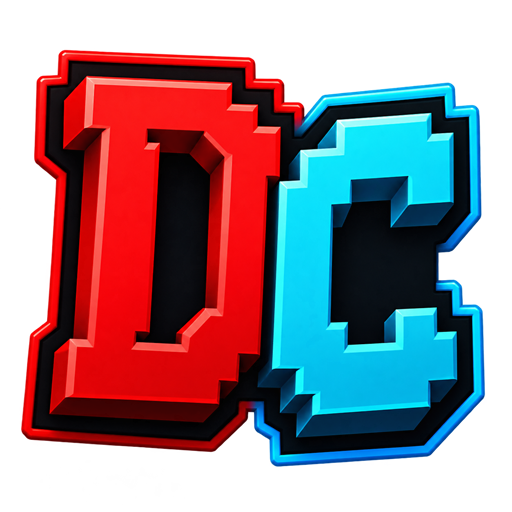

# ☠️ DeathCraft

\<p align="center">
&#x20; \
\</p>

\<h3 align="center">A Minecraft Gaming Network & Web Platform\</h3>

\<p align="center">   \<b>Build. Explore. Compete. Survive.\</b> \</p>

\<p align="center">   \<a href="[https://deathcraft.ir/](https://deathcraft.ir/)">Website\</a> •   \<a href="[https://github.com/hesigame/DeathCraft](https://github.com/hesigame/DeathCraft)">GitHub\</a> •   \<a href="[https://rubika.ir/DeathCraft](https://rubika.ir/DeathCraft)">Community\</a> \</p>

---

## 🌐 About DeathCraft

**DeathCraft** is an independent Minecraft gaming network and web platform built to deliver an engaging, accessible, and enjoyable experience for the Minecraft community.

The project combines a custom-designed website, player services, server information, and gaming features into one centralized platform.

Our goal is to continuously improve the Minecraft experience through technology, creativity, and community-driven development.

## 🎮 Game Modes

### ☁️ SkyMine

Explore your own island, collect resources, expand your world, build your economy, and compete with other players.

### 🕹️ Arcade

Enjoy exciting multiplayer mini-games, fast-paced challenges, and competitive gameplay with friends.

## ✨ Website Features

- Modern and responsive user interface
- Dark and light theme support
- Official server information and status
- Dedicated rules and information pages
- Player statistics and server monitoring
- User account and panel integration
- Application download page
- Progressive Web App (PWA) support
- Mobile-friendly experience
- SEO and social media metadata
- Custom visual design and animations

## 🛠️ Technologies

DeathCraft's web platform is built using:

- **HTML5** – Website structure
- **CSS3** – Responsive layouts and visual design
- **JavaScript** – Interactive features and functionality
- **PWA** – Installable web experience
- **JSON** – Configuration and application metadata
- **GitHub Pages** – Website hosting and deployment

## 📂 Project Structure

```text
DeathCraft/
├── assets/
│   ├── css/
│   ├── js/
│   ├── images/
│   └── ...
├── index.html
├── info.html
├── auth.html
├── download.html
├── panel.html
├── rules.html
├── stats.html
├── 404.html
├── manifest.json
├── sw.js
├── robots.txt
├── sitemap.xml
└── CNAME
```

## 🚀 Getting Started

You can explore or run the website locally.

1. Clone the repository:

```bash
git clone https://github.com/hesigame/DeathCraft.git
```

2. Open the project directory:

```bash
cd DeathCraft
```

3. Open `index.html` in your browser or use a local development server.

## 🌍 Join DeathCraft

| Service           | Address                                                                          |
| ----------------- | -------------------------------------------------------------------------------- |
| Official Website  | [https://deathcraft.ir/](https://deathcraft.ir/)                                 |
| Minecraft Server  | `Play.DeathCraft.IR`                                                             |
| GitHub Repository | [https://github.com/hesigame/DeathCraft](https://github.com/hesigame/DeathCraft) |
| Community         | [https://rubika.ir/DeathCraft](https://rubika.ir/DeathCraft)                     |

**Minecraft Edition:** Java Edition

**Advertised Version Compatibility:** 1.8 – 26

## 👨‍💻 Development

DeathCraft is an independently developed project maintained by its development team.

The repository documents ongoing development, improvements, and updates to the platform.

We believe in building reliable digital experiences and continuously exploring new technologies to improve the project.

## 🤝 Contributions

Suggestions, ideas, and feedback are welcome.

If you find an issue or have an idea for improvement, feel free to open a GitHub Issue.

## 📌 Roadmap

- [x] Official website
- [x] Responsive design
- [x] Server information pages
- [x] Rules and statistics pages
- [x] PWA foundation
- [x] Windows application download page
- [ ] Android application release
- [ ] More player-focused features
- [ ] AI-powered support and assistance
- [ ] Continuous platform improvements

## 📜 License

All rights reserved © 2026 DeathCraft.

Unless otherwise stated, the source code, branding, graphics, and project assets are proprietary to their respective owners. No permission to redistribute or commercially reuse them is granted by this repository.

---

\<p align="center">   \<b>☠️ DeathCraft — More Than Just Minecraft.\</b>   \<br>   \<sub>Built with passion for the Minecraft community.\</sub>   \<br>\<br>   \<a href="[https://deathcraft.ir/](https://deathcraft.ir/)">deathcraft.ir\</a> \</p>
****
